# Built-in templates

| Template                 | When to send it                                                                                                | Subject in English                                        |
| ------------------------ | -------------------------------------------------------------------------------------------------------------- | --------------------------------------------------------- |
| `verifyEmail`            | A user signed up and needs to confirm their email address                                                      | Confirm your email                                        |
| `resetPassword`          | A user asked to reset a forgotten password                                                                     | Reset your password                                       |
| `passwordChanged`        | A password was changed, so the owner can act if it was not them                                                | Your password was changed                                 |
| `verifyEmailChange`      | A user asked to change their email; sent to the new address to confirm it                                      | Confirm your new email                                    |
| `emailChangeRequested`   | A user asked to change their email; sent to the current address, so the owner can cancel it if it was not them | Email change requested                                    |
| `emailChanged`           | The email was changed; sent to the old address, so the owner can act if it was not them                        | Your email was changed                                    |
| `otpCode`                | A user needs a one-time code, such as for sign-in, two-step verification or confirming an action               | Your verification code                                    |
| `magicLink`              | A user signs in with a link instead of a password                                                              | Your sign-in link                                         |
| `welcome`                | A new account is ready                                                                                         | Welcome to {companyName}                                  |
| `newSignIn`              | Someone signed in to an account, such as from a new device, so the owner can act if it was not them            | New sign-in to your account                               |
| `twoFactorEnabled`       | Two-factor authentication was turned on, so the owner can act if it was not them                               | Two-factor authentication was turned on                   |
| `twoFactorDisabled`      | Two-factor authentication was turned off, so the owner can act if it was not them                              | Two-factor authentication was turned off                  |
| `accountLocked`          | An account was locked after too many failed sign-in attempts                                                   | Your account is locked                                    |
| `confirmAccountDeletion` | A user asked to delete their account and needs to confirm it                                                   | Confirm account deletion                                  |
| `accountDeleted`         | An account was deleted, so the owner can act if it was not them                                                | Your account was deleted                                  |
| `teamInvite`             | Someone invites a person to join an organization, team or workspace in your app                                | Join {organizationName} on {companyName}                  |
| `userInvite`             | An account was created for someone, such as by an admin, who finishes setting it up through the link           | You're invited to {companyName}                           |
| `inviteAccepted`         | An invitation was accepted; sent to the person who sent it                                                     | {memberName} accepted your invitation                     |
| `memberRoleChanged`      | A member's role in an organization changed                                                                     | Your role in {organizationName} was changed               |
| `memberRemoved`          | A member was removed from an organization                                                                      | You were removed from {organizationName}                  |
| `ownershipReceived`      | Ownership of an organization was transferred; sent to the new owner                                            | You're now the owner of {organizationName}                |
| `ownershipTransferred`   | Ownership of an organization was transferred; sent to the former owner, so they can act if it was not them     | Ownership of {organizationName} was transferred           |
| `passkeyAdded`           | A passkey was added to an account, so the owner can act if it was not them                                     | A passkey was added to your account                       |
| `passkeyRemoved`         | A passkey was removed from an account, so the owner can act if it was not them                                 | A passkey was removed from your account                   |
| `recoveryCodeUsed`       | Someone signed in with a two-factor recovery code, so the owner can act if it was not them                     | A recovery code was used                                  |
| `apiKeyCreated`          | An API key or personal access token was created, so the owner can act if it was not them                       | A new API key was created                                 |
| `apiKeyExpiring`         | An API key or personal access token expires soon                                                               | Your API key expires soon                                 |
| `accountUnlocked`        | A locked account was unlocked                                                                                  | Your account is unlocked                                  |
| `dataExportReady`        | A copy of the user's data, such as for a GDPR request, is ready to download                                    | Your data export is ready                                 |
| `inactiveAccountWarning` | An inactive account will be deleted unless the owner signs in                                                  | Your account will be deleted soon                         |
| `policyUpdated`          | The terms of service or the privacy policy change                                                              | Updates to our Terms of Service, or to our Privacy Policy |

Each email has an inbox preview text, a heading, a greeting and a short explanation. Where there is a link, it adds a button and the same link as plain text for readers whose button does not work. Most emails end with a note for recipients who did not expect them, or with what to do if they did not make the change.

## `verifyEmail`

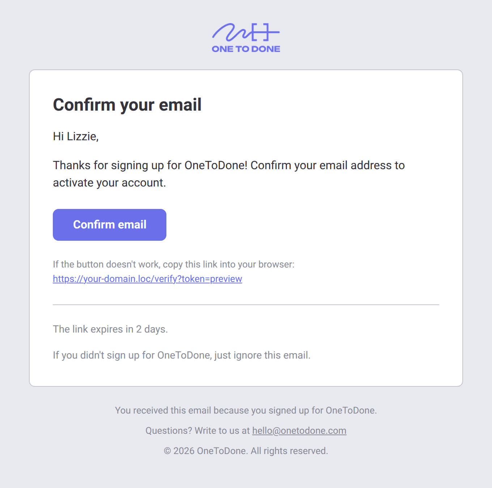

| Prop               | Type     | Required | Description                                                                         |
| ------------------ | -------- | -------- | ----------------------------------------------------------------------------------- |
| `verifyUrl`        | `string` | yes      | Absolute `http:` or `https:` link that confirms the address.                        |
| `userName`         | `string` | no       | Name for the greeting. Without it, or when it is empty, the greeting has no name.   |
| `expiresInMinutes` | `number` | no       | How long the link works, in minutes. Without it, the email does not mention expiry. |

## `resetPassword`

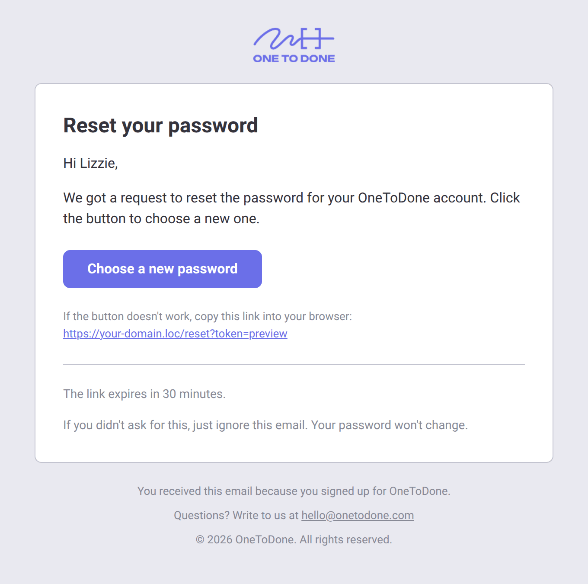

| Prop               | Type     | Required | Description                                                                         |
| ------------------ | -------- | -------- | ----------------------------------------------------------------------------------- |
| `resetUrl`         | `string` | yes      | Absolute `http:` or `https:` link to the page where the user sets a new password.   |
| `userName`         | `string` | no       | Name for the greeting. Without it, or when it is empty, the greeting has no name.   |
| `expiresInMinutes` | `number` | no       | How long the link works, in minutes. Without it, the email does not mention expiry. |

## `passwordChanged`

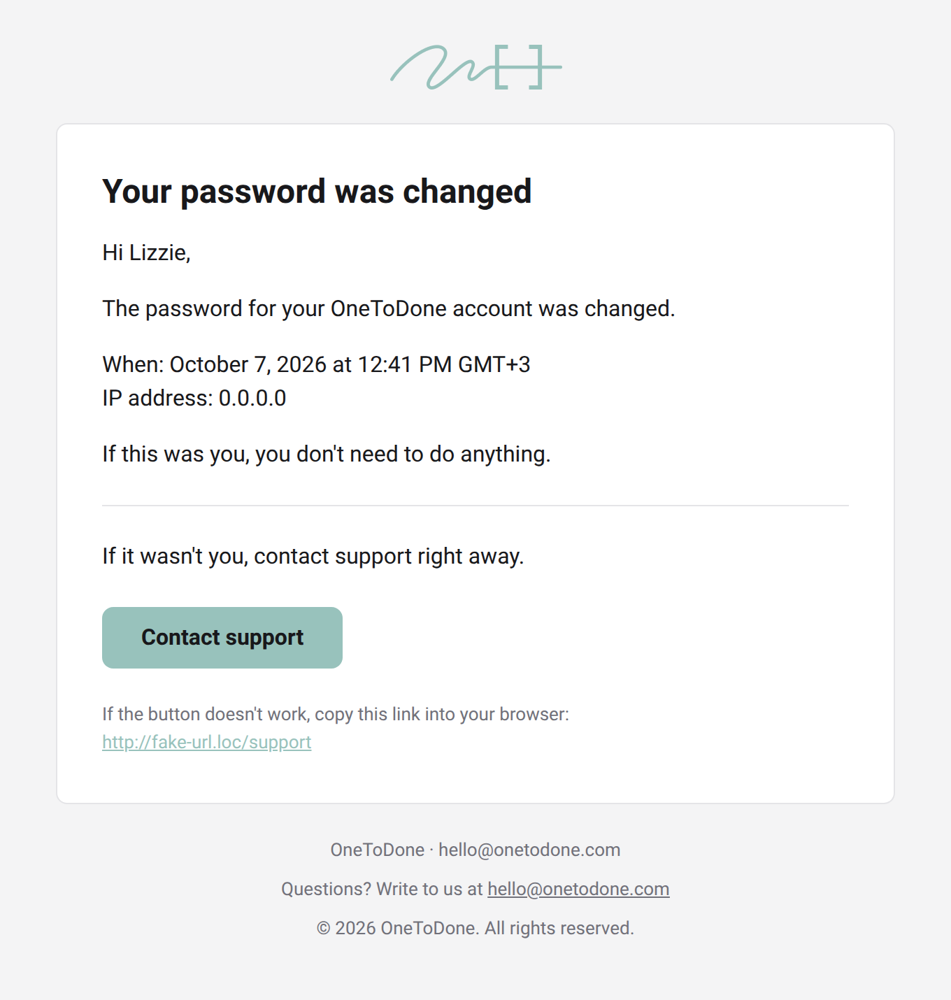

Every prop is optional, so `props` can be left out.

| Prop         | Type     | Description                                                                                                                         |
| ------------ | -------- | ----------------------------------------------------------------------------------------------------------------------------------- |
| `userName`   | `string` | Name for the greeting. Without it, or when it is empty, the greeting has no name.                                                   |
| `changedAt`  | `Date`   | When the password was changed.                                                                                                      |
| `timeZone`   | `string` | IANA time zone for `changedAt`, such as `Europe/Berlin`. Default: the mailer's `timeZone`, which is UTC unless you set it.          |
| `ip`         | `string` | IP address the change came from.                                                                                                    |
| `supportUrl` | `string` | Absolute `http:` or `https:` link to your support page, shown as a button. Without it, the email points to `branding.supportEmail`. |

```ts
await mailer.send('passwordChanged', { to: 'lizzie@example.com' })

await mailer.send('passwordChanged', {
  to: 'lizzie@example.com',
  props: {
    userName: 'Lizzie',
    changedAt: new Date(),
    timeZone: 'Europe/Berlin',
    ip: '203.0.113.7',
    supportUrl: 'https://example.com/support',
  },
})
```

## `verifyEmailChange`

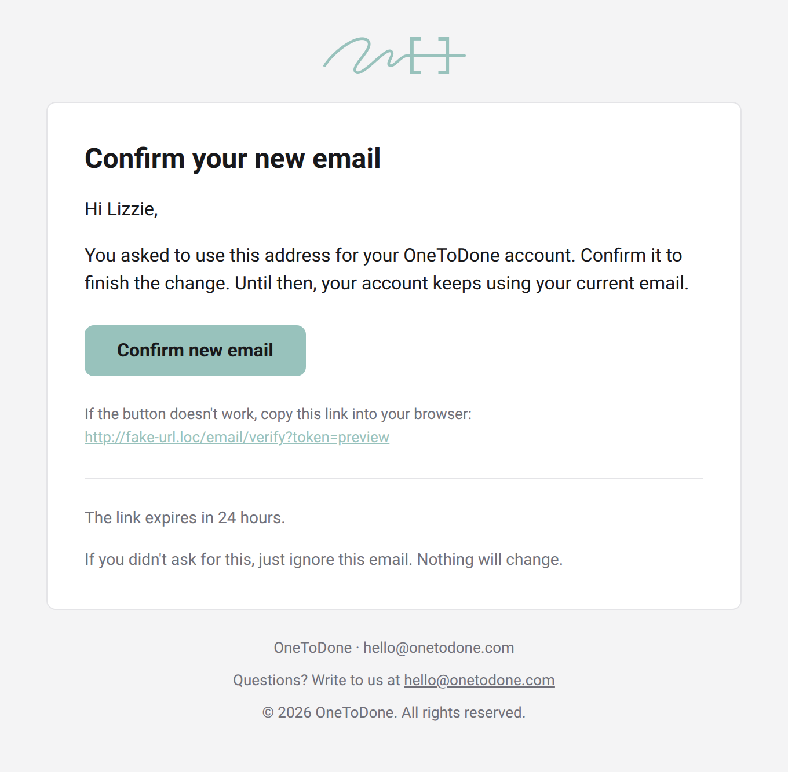

Send it to the new address. The account keeps its current email until the link is opened.

| Prop               | Type     | Required | Description                                                                         |
| ------------------ | -------- | -------- | ----------------------------------------------------------------------------------- |
| `verifyUrl`        | `string` | yes      | Absolute `http:` or `https:` link that confirms the new address.                    |
| `userName`         | `string` | no       | Name for the greeting. Without it, or when it is empty, the greeting has no name.   |
| `expiresInMinutes` | `number` | no       | How long the link works, in minutes. Without it, the email does not mention expiry. |

## `emailChangeRequested`

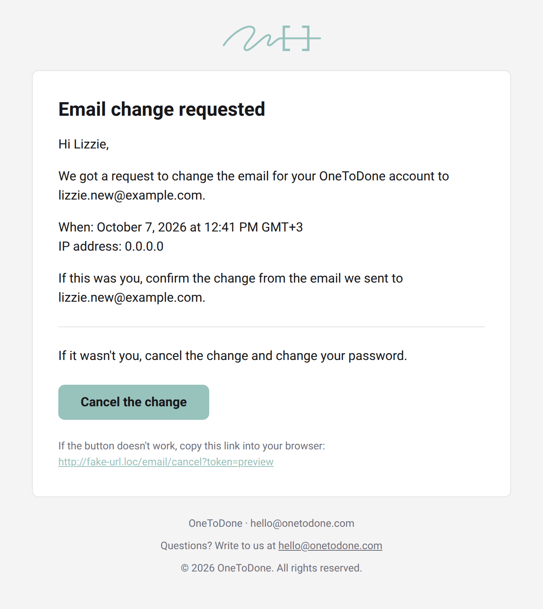

Send it to the current address when the change is requested, so the owner can stop a change they did not make.

| Prop          | Type     | Required | Description                                                                                                                                                          |
| ------------- | -------- | -------- | -------------------------------------------------------------------------------------------------------------------------------------------------------------------- |
| `newEmail`    | `string` | yes      | The address the account is moving to. Any non-empty text, so you can pass a masked address such as `l***@example.com`.                                               |
| `userName`    | `string` | no       | Name for the greeting. Without it, or when it is empty, the greeting has no name.                                                                                    |
| `requestedAt` | `Date`   | no       | When the change was requested.                                                                                                                                       |
| `timeZone`    | `string` | no       | IANA time zone for `requestedAt`, such as `Europe/Berlin`. Default: the mailer's `timeZone`, which is UTC unless you set it.                                         |
| `ip`          | `string` | no       | IP address the request came from.                                                                                                                                    |
| `cancelUrl`   | `string` | no       | Absolute `http:` or `https:` link that cancels the change, shown as a button. Without it, the email points to support.                                               |
| `supportUrl`  | `string` | no       | Absolute `http:` or `https:` link to your support page, shown as a button when there is no `cancelUrl`. Without either, the email points to `branding.supportEmail`. |

## `emailChanged`

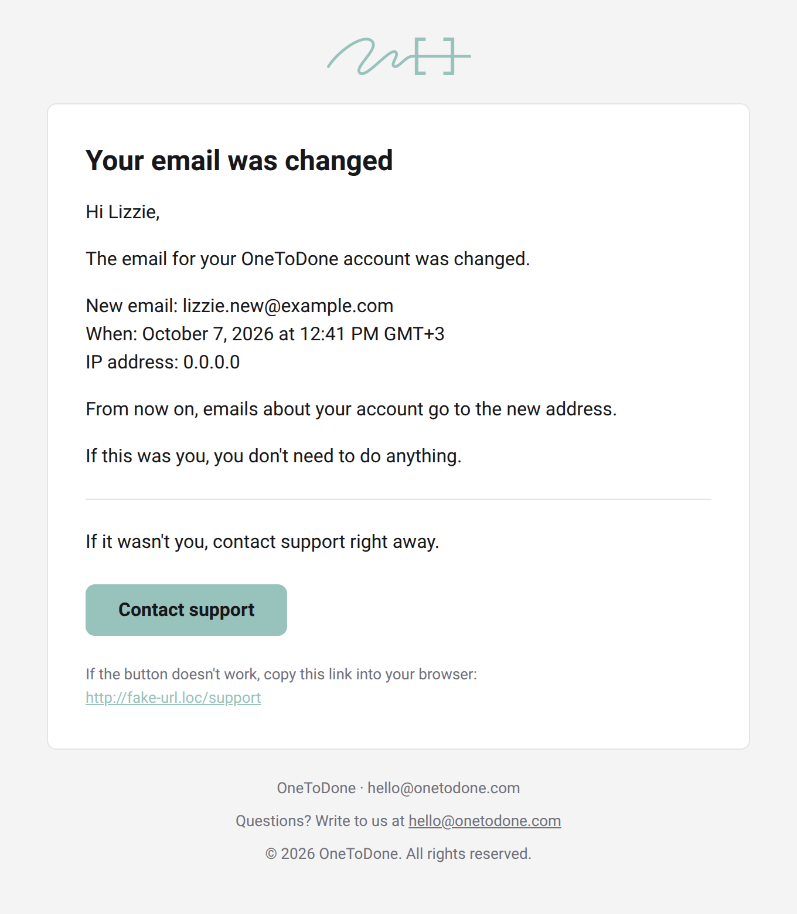

Send it to the old address once the new one is confirmed. Every prop is optional, so `props` can be left out.

| Prop         | Type     | Description                                                                                                                                            |
| ------------ | -------- | ------------------------------------------------------------------------------------------------------------------------------------------------------ |
| `userName`   | `string` | Name for the greeting. Without it, or when it is empty, the greeting has no name.                                                                      |
| `newEmail`   | `string` | The new address. Any non-empty text, so you can pass a masked address such as `l***@example.com`. Without it, the email does not name the new address. |
| `changedAt`  | `Date`   | When the email was changed.                                                                                                                            |
| `timeZone`   | `string` | IANA time zone for `changedAt`, such as `Europe/Berlin`. Default: the mailer's `timeZone`, which is UTC unless you set it.                             |
| `ip`         | `string` | IP address the change came from.                                                                                                                       |
| `supportUrl` | `string` | Absolute `http:` or `https:` link to your support page, shown as a button. Without it, the email points to `branding.supportEmail`.                    |

An email change uses all three:

```ts
// When the user asks for the change
await mailer.send('emailChangeRequested', {
  to: 'lizzie@example.com',
  props: { newEmail: 'lizzie.new@example.com', cancelUrl: 'https://example.com/email/cancel?token=abc123' },
})
await mailer.send('verifyEmailChange', {
  to: 'lizzie.new@example.com',
  props: { verifyUrl: 'https://example.com/email/verify?token=def456', expiresInMinutes: 1440 },
})

// Once the new address is confirmed
await mailer.send('emailChanged', {
  to: 'lizzie@example.com',
  props: { newEmail: 'lizzie.new@example.com', changedAt: new Date() },
})
```

## `otpCode`

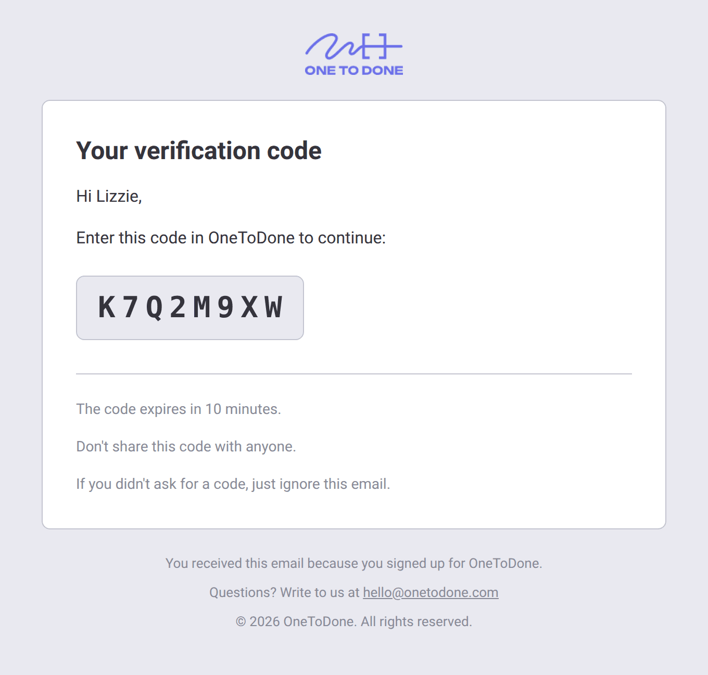

A one-time code for any purpose, such as sign-in, two-step verification or confirming an action.

| Prop               | Type     | Required | Description                                                                                   |
| ------------------ | -------- | -------- | --------------------------------------------------------------------------------------------- |
| `code`             | `string` | yes      | The code to enter, such as `482913`. Codes of up to 8 characters fit on narrow phone screens. |
| `userName`         | `string` | no       | Name for the greeting. Without it, or when it is empty, the greeting has no name.             |
| `expiresInMinutes` | `number` | no       | How long the code works, in minutes. Without it, the email does not mention expiry.           |

```ts
await mailer.send('otpCode', {
  to: 'lizzie@example.com',
  props: { code: '482913', expiresInMinutes: 10 },
})
```

The subject and the inbox preview leave out the code, because they show in notifications and on lock screens. Both texts accept `{code}`, so a [text override](locales.md) such as `{ en: { otpCode: { subject: 'Your code: {code}' } } }` puts it back.

## `magicLink`

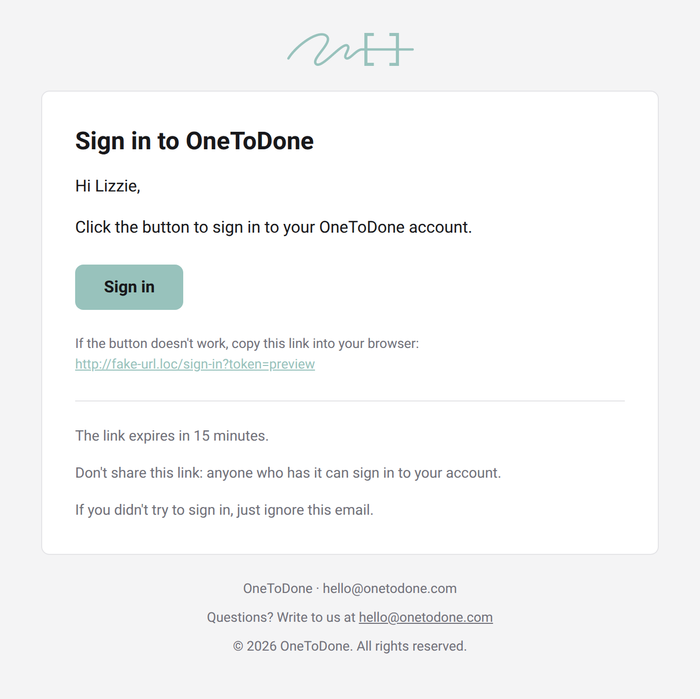

| Prop               | Type     | Required | Description                                                                         |
| ------------------ | -------- | -------- | ----------------------------------------------------------------------------------- |
| `signInUrl`        | `string` | yes      | Absolute `http:` or `https:` link that signs the user in.                           |
| `userName`         | `string` | no       | Name for the greeting. Without it, or when it is empty, the greeting has no name.   |
| `expiresInMinutes` | `number` | no       | How long the link works, in minutes. Without it, the email does not mention expiry. |

Anyone who has the link can sign in, and the email tells the reader not to share it. Make the link work once and for a short time, such as 15 minutes.

## `welcome`

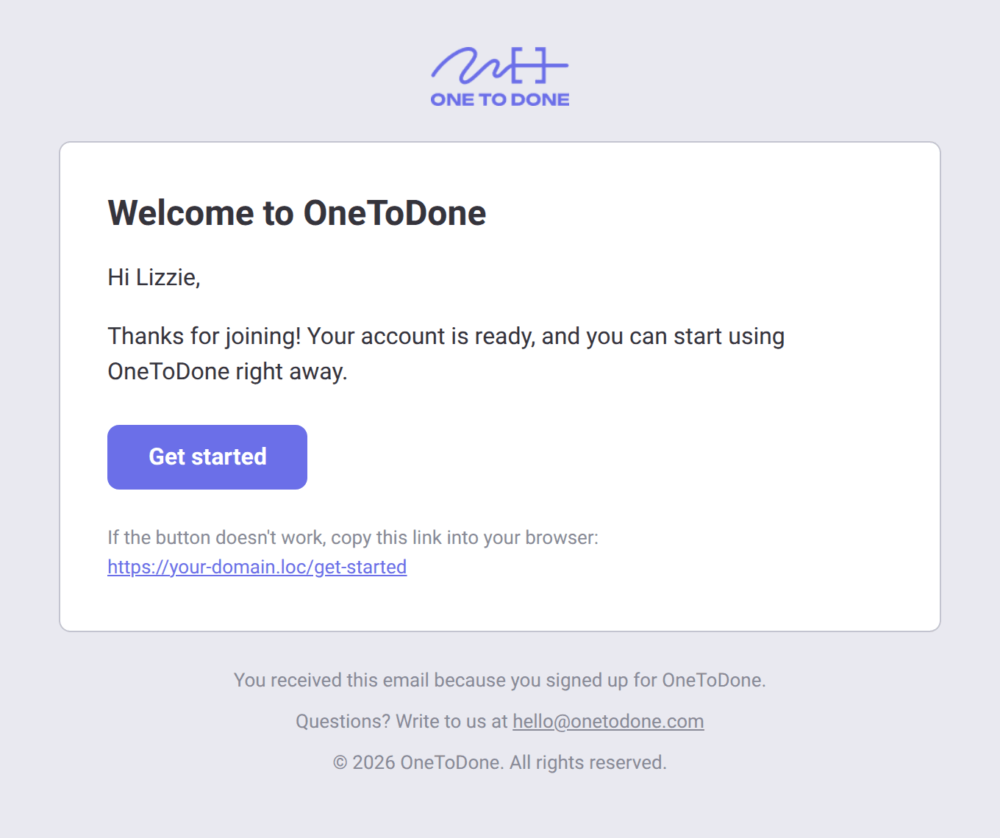

Send it once the account is ready, for example after the email address is confirmed. Every prop is optional, so `props` can be left out.

| Prop       | Type     | Description                                                                                                                |
| ---------- | -------- | -------------------------------------------------------------------------------------------------------------------------- |
| `userName` | `string` | Name for the greeting. Without it, or when it is empty, the greeting has no name.                                          |
| `startUrl` | `string` | Absolute `http:` or `https:` link behind the "Get started" button, such as an onboarding page. Default: `branding.appUrl`. |

```ts
await mailer.send('welcome', { to: 'lizzie@example.com', props: { userName: 'Lizzie' } })
```

## `newSignIn`

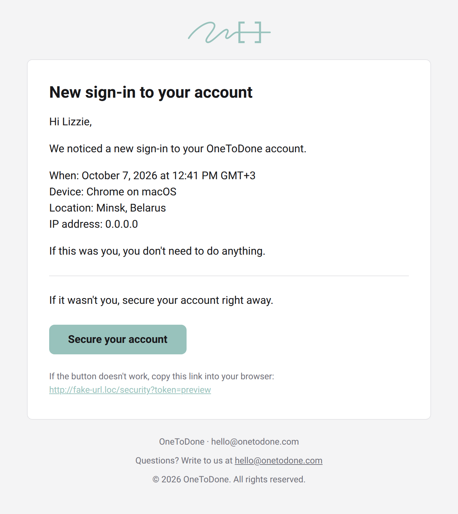

Send it when someone signs in to the account, for example from a device or place the account has not used before. Every prop is optional, so `props` can be left out.

| Prop         | Type     | Description                                                                                                                                                                                                   |
| ------------ | -------- | ------------------------------------------------------------------------------------------------------------------------------------------------------------------------------------------------------------- |
| `userName`   | `string` | Name for the greeting. Without it, or when it is empty, the greeting has no name.                                                                                                                             |
| `signedInAt` | `Date`   | When the sign-in happened.                                                                                                                                                                                    |
| `timeZone`   | `string` | IANA time zone for `signedInAt`, such as `Europe/Berlin`. Default: the mailer's `timeZone`, which is UTC unless you set it.                                                                                   |
| `ip`         | `string` | IP address the sign-in came from.                                                                                                                                                                             |
| `device`     | `string` | Device or browser of the sign-in, such as `Chrome on macOS`.                                                                                                                                                  |
| `location`   | `string` | Approximate location of the sign-in, such as `Berlin, Germany`.                                                                                                                                               |
| `secureUrl`  | `string` | Absolute `http:` or `https:` link to a page where the owner secures the account, such as by changing the password and signing out other sessions, shown as a button. Without it, the email points to support. |
| `supportUrl` | `string` | Absolute `http:` or `https:` link to your support page, shown as a button when there is no `secureUrl`. Without either, the email points to `branding.supportEmail`.                                          |

```ts
await mailer.send('newSignIn', {
  to: 'lizzie@example.com',
  props: {
    signedInAt: new Date(),
    device: 'Chrome on macOS',
    location: 'Berlin, Germany',
    ip: '203.0.113.7',
    secureUrl: 'https://example.com/security',
  },
})
```

The email shows `device` and `location` as you pass them, for example from the user agent and an IP geolocation lookup.

## `twoFactorEnabled` and `twoFactorDisabled`

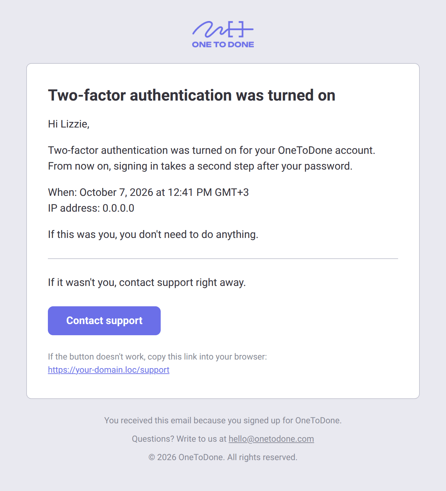 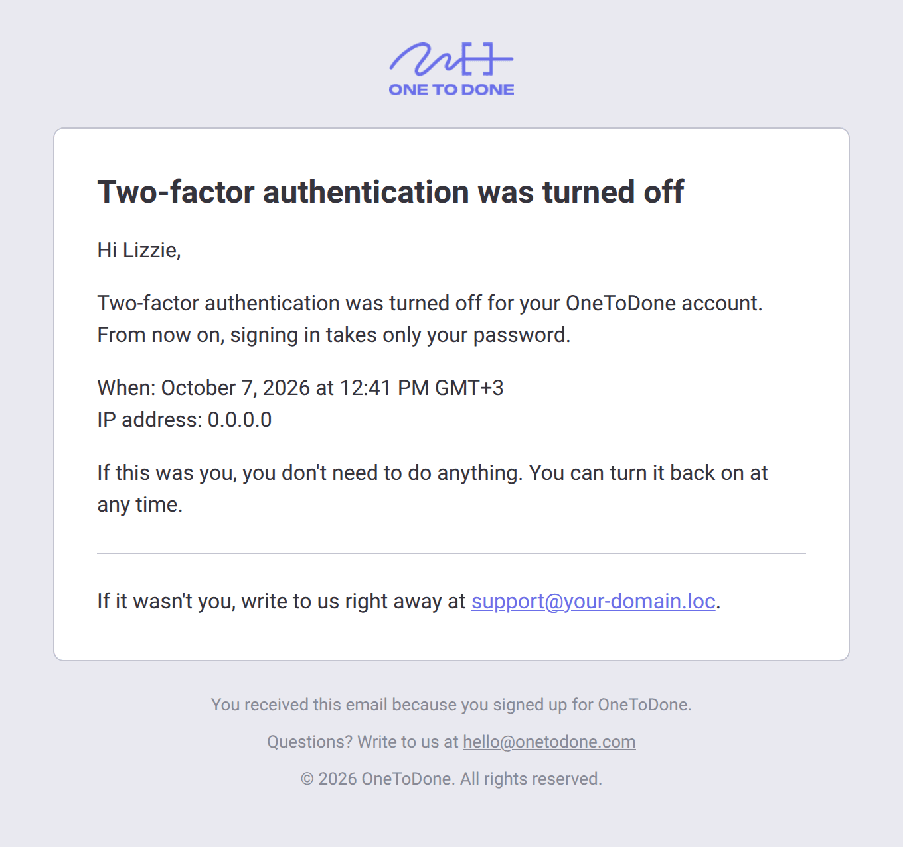

Send them when two-factor authentication is turned on or off for an account. Both take the same props. Every prop is optional, so `props` can be left out.

| Prop         | Type     | Description                                                                                                                         |
| ------------ | -------- | ----------------------------------------------------------------------------------------------------------------------------------- |
| `userName`   | `string` | Name for the greeting. Without it, or when it is empty, the greeting has no name.                                                   |
| `changedAt`  | `Date`   | When two-factor authentication was turned on or off.                                                                                |
| `timeZone`   | `string` | IANA time zone for `changedAt`, such as `Europe/Berlin`. Default: the mailer's `timeZone`, which is UTC unless you set it.          |
| `ip`         | `string` | IP address the change came from.                                                                                                    |
| `supportUrl` | `string` | Absolute `http:` or `https:` link to your support page, shown as a button. Without it, the email points to `branding.supportEmail`. |

```ts
await mailer.send('twoFactorDisabled', {
  to: 'lizzie@example.com',
  props: { changedAt: new Date(), ip: '203.0.113.7' },
})
```

## `accountLocked`

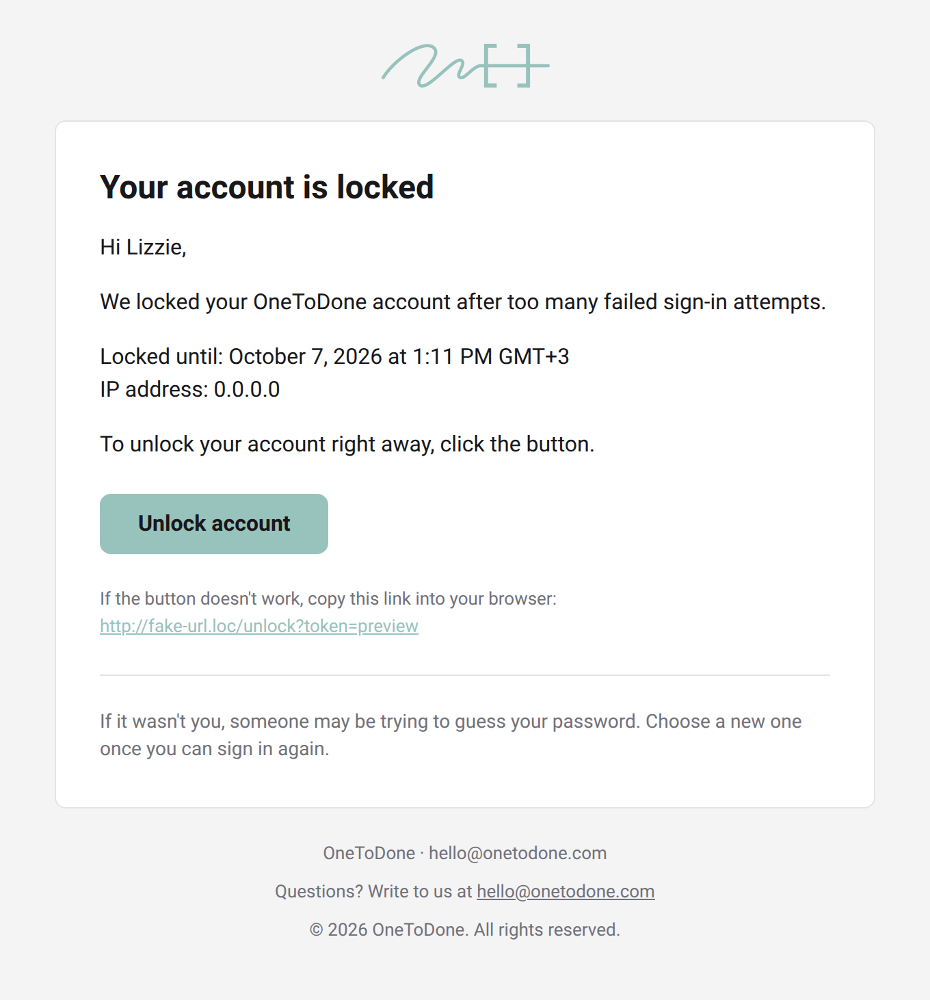

Send it when the account is locked after too many failed sign-in attempts. Every prop is optional, so `props` can be left out.

| Prop          | Type     | Description                                                                                                                                                          |
| ------------- | -------- | -------------------------------------------------------------------------------------------------------------------------------------------------------------------- |
| `userName`    | `string` | Name for the greeting. Without it, or when it is empty, the greeting has no name.                                                                                    |
| `lockedUntil` | `Date`   | When the lock ends. Without it, the email does not say when.                                                                                                         |
| `timeZone`    | `string` | IANA time zone for `lockedUntil`, such as `Europe/Berlin`. Default: the mailer's `timeZone`, which is UTC unless you set it.                                         |
| `ip`          | `string` | IP address the failed sign-in attempts came from.                                                                                                                    |
| `unlockUrl`   | `string` | Absolute `http:` or `https:` link that unlocks the account, shown as a button. Without it, the email offers help from support.                                       |
| `supportUrl`  | `string` | Absolute `http:` or `https:` link to your support page, shown as a button when there is no `unlockUrl`. Without either, the email points to `branding.supportEmail`. |

```ts
await mailer.send('accountLocked', {
  to: 'lizzie@example.com',
  props: { lockedUntil: new Date(Date.now() + 30 * 60_000), ip: '203.0.113.7' },
})
```

The email ends with advice for owners who did not try to sign in: someone may be guessing the password, so choose a new one.

## `confirmAccountDeletion`

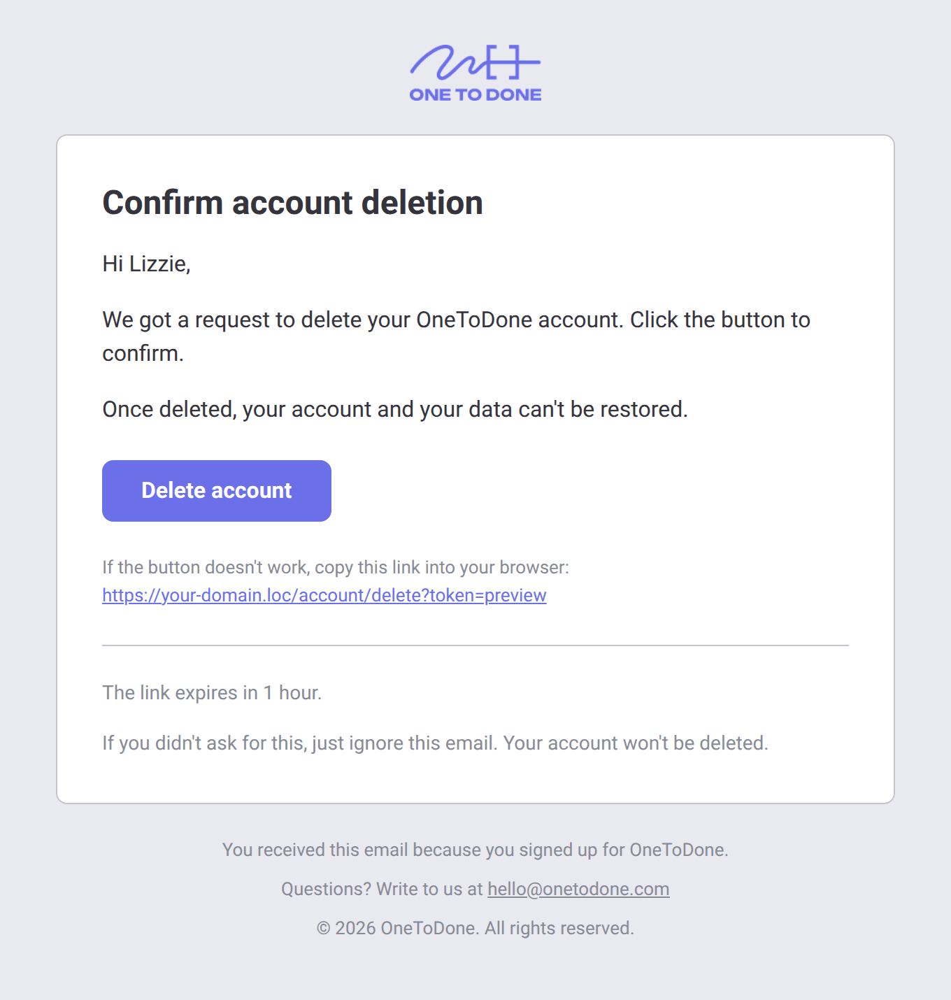

Send it when a user asks to delete their account, and delete the account only once the link is opened.

| Prop               | Type     | Required | Description                                                                         |
| ------------------ | -------- | -------- | ----------------------------------------------------------------------------------- |
| `confirmUrl`       | `string` | yes      | Absolute `http:` or `https:` link that confirms the deletion.                       |
| `userName`         | `string` | no       | Name for the greeting. Without it, or when it is empty, the greeting has no name.   |
| `expiresInMinutes` | `number` | no       | How long the link works, in minutes. Without it, the email does not mention expiry. |

## `accountDeleted`

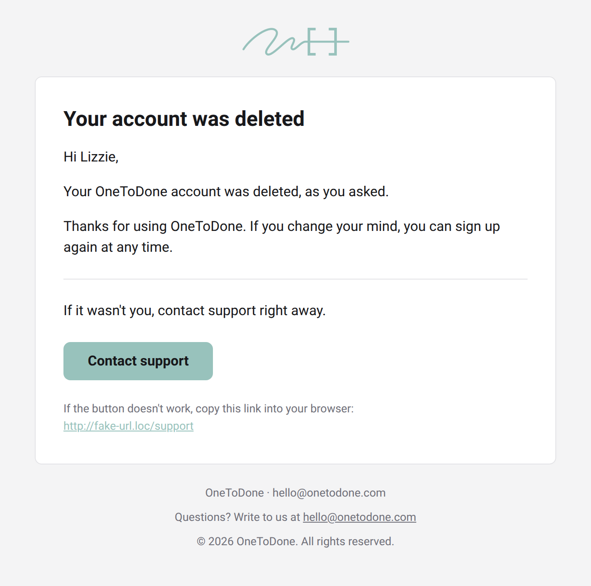

Send it once the account is deleted. Every prop is optional, so `props` can be left out.

| Prop         | Type     | Description                                                                                                                         |
| ------------ | -------- | ----------------------------------------------------------------------------------------------------------------------------------- |
| `userName`   | `string` | Name for the greeting. Without it, or when it is empty, the greeting has no name.                                                   |
| `supportUrl` | `string` | Absolute `http:` or `https:` link to your support page, shown as a button. Without it, the email points to `branding.supportEmail`. |

An account deletion uses both:

```ts
// When the user asks to delete the account
await mailer.send('confirmAccountDeletion', {
  to: 'lizzie@example.com',
  props: { confirmUrl: 'https://example.com/account/delete?token=abc123', expiresInMinutes: 60 },
})

// Once the account is deleted
await mailer.send('accountDeleted', { to: 'lizzie@example.com', props: { userName: 'Lizzie' } })
```

`confirmAccountDeletion` warns that a deleted account and its data can't be restored, and `accountDeleted` says the owner can sign up again. If your app keeps deleted accounts for a grace period, change `confirmAccountDeletion.warning` and `accountDeleted.farewell` through [`messages`](locales.md). Every email shows `branding.footerText`, so word it to fit a deleted account too.

## `teamInvite`

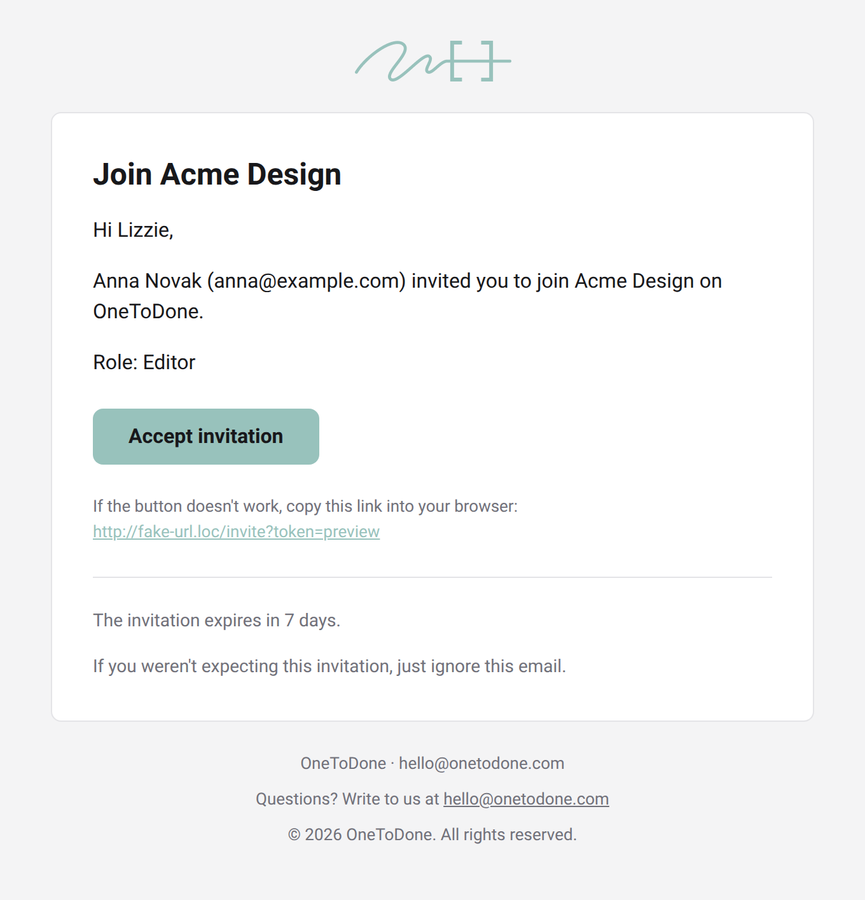

Send it when someone invites a person to join an organization, team or workspace in your app. The recipient may not have an account yet.

| Prop               | Type     | Required | Description                                                                                                                                                          |
| ------------------ | -------- | -------- | -------------------------------------------------------------------------------------------------------------------------------------------------------------------- |
| `organizationName` | `string` | yes      | Name of the organization, team or workspace.                                                                                                                         |
| `acceptUrl`        | `string` | yes      | Absolute `http:` or `https:` link that accepts the invitation.                                                                                                       |
| `userName`         | `string` | no       | Name for the greeting. Without it, or when it is empty, the greeting has no name.                                                                                    |
| `inviterName`      | `string` | no       | Name of the person who sent the invitation.                                                                                                                          |
| `inviterEmail`     | `string` | no       | Email address of the person who sent the invitation. With `inviterName`, the email shows `Anna (anna@example.com)`. Without both, it says the recipient was invited. |
| `role`             | `string` | no       | Role the recipient gets on joining, such as `Editor`, shown as you pass it.                                                                                          |
| `expiresInMinutes` | `number` | no       | How long the invitation works, in minutes. Without it, the email does not mention expiry.                                                                            |

```ts
await mailer.send('teamInvite', {
  to: 'tom@example.com',
  props: {
    inviterName: 'Lizzie',
    organizationName: 'Acme Design',
    role: 'Editor',
    acceptUrl: 'https://example.com/invitations/abc123',
    expiresInMinutes: 7 * 24 * 60,
  },
})
```

## `userInvite`

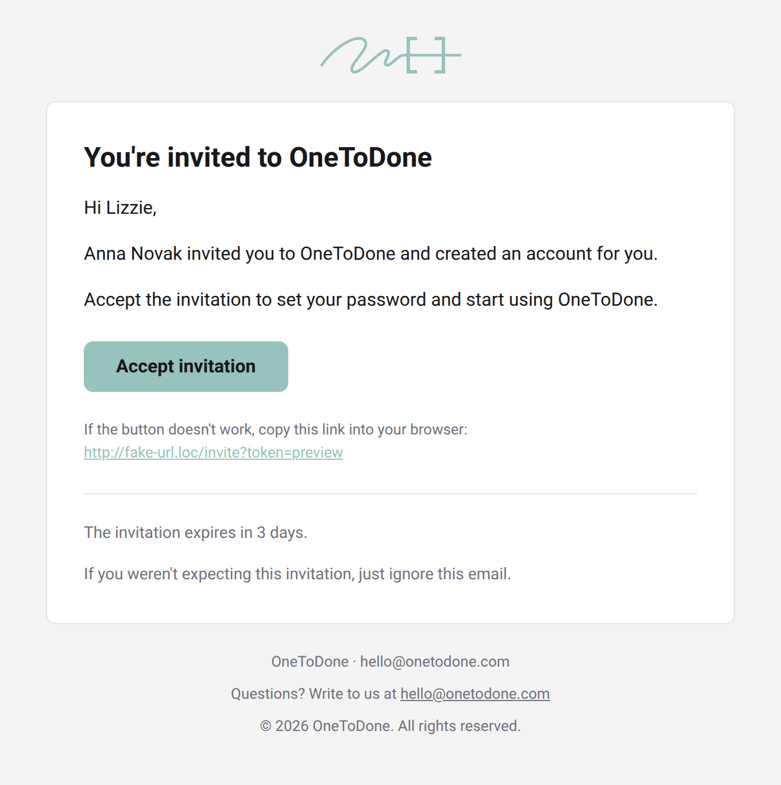

Send it when an account is created for someone, such as by an admin, and they finish setting it up through the link, for example by choosing a password. To invite someone into a part of your app, use `teamInvite`.

| Prop               | Type     | Required | Description                                                                                                   |
| ------------------ | -------- | -------- | ------------------------------------------------------------------------------------------------------------- |
| `acceptUrl`        | `string` | yes      | Absolute `http:` or `https:` link that accepts the invitation, such as a page where the user sets a password. |
| `userName`         | `string` | no       | Name for the greeting. Without it, or when it is empty, the greeting has no name.                             |
| `inviterName`      | `string` | no       | Name of the person who sent the invitation.                                                                   |
| `inviterEmail`     | `string` | no       | Email address of the person who sent the invitation, shown as in `teamInvite`.                                |
| `expiresInMinutes` | `number` | no       | How long the invitation works, in minutes. Without it, the email does not mention expiry.                     |

## `inviteAccepted`

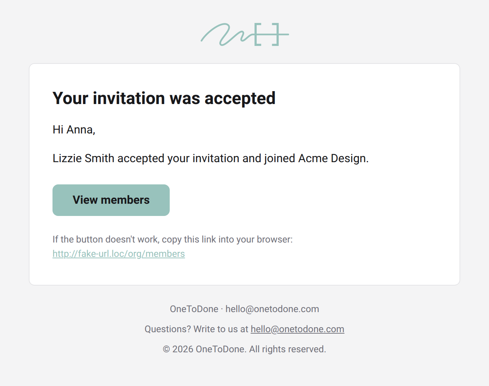

Send it to the person who sent an invitation once it is accepted.

| Prop               | Type     | Required | Description                                                                                                                  |
| ------------------ | -------- | -------- | ---------------------------------------------------------------------------------------------------------------------------- |
| `memberName`       | `string` | yes      | Name or email address of the person who accepted the invitation.                                                             |
| `userName`         | `string` | no       | Name of the recipient, who sent the invitation, for the greeting. Without it, or when it is empty, the greeting has no name. |
| `organizationName` | `string` | no       | Organization, team or workspace the person joined. Without it, the email names your app.                                     |
| `membersUrl`       | `string` | no       | Absolute `http:` or `https:` link to the list of members, shown as a button. Without it, the email has no button.            |

## `memberRoleChanged`

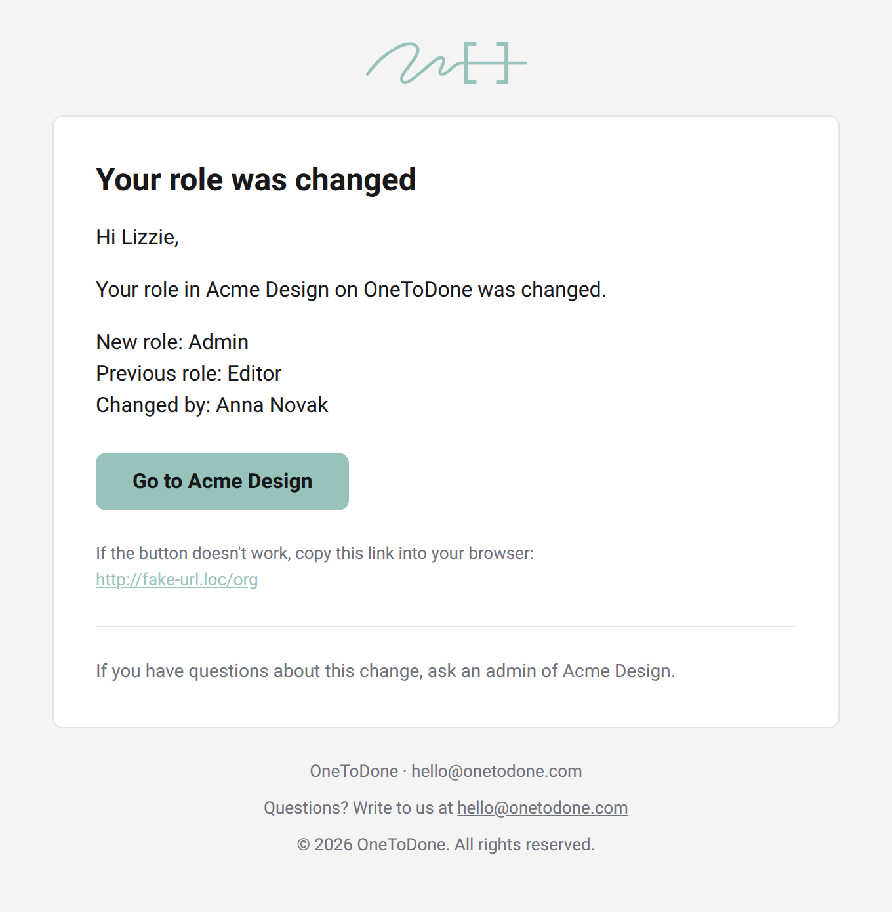

Send it to a member whose role in an organization, team or workspace changed. The email ends by pointing to the organization's admins for questions.

| Prop               | Type     | Required | Description                                                                                                                |
| ------------------ | -------- | -------- | -------------------------------------------------------------------------------------------------------------------------- |
| `organizationName` | `string` | yes      | Name of the organization, team or workspace.                                                                               |
| `role`             | `string` | yes      | The new role, such as `Admin`, shown as you pass it.                                                                       |
| `userName`         | `string` | no       | Name for the greeting. Without it, or when it is empty, the greeting has no name.                                          |
| `previousRole`     | `string` | no       | The role before the change.                                                                                                |
| `changedByName`    | `string` | no       | Name of the person who changed the role.                                                                                   |
| `organizationUrl`  | `string` | no       | Absolute `http:` or `https:` link to the organization in your app, shown as a button. Without it, the email has no button. |

## `memberRemoved`

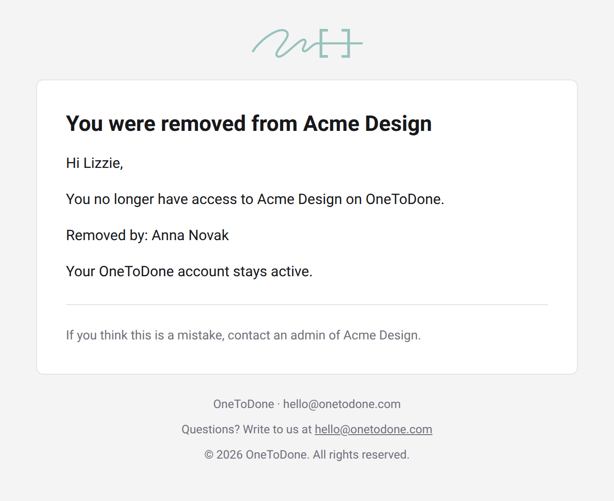

Send it to a member removed from an organization, team or workspace. The email says that the member's own account stays active and points to the organization's admins if it is a mistake.

| Prop               | Type     | Required | Description                                                                       |
| ------------------ | -------- | -------- | --------------------------------------------------------------------------------- |
| `organizationName` | `string` | yes      | Name of the organization, team or workspace.                                      |
| `userName`         | `string` | no       | Name for the greeting. Without it, or when it is empty, the greeting has no name. |
| `removedByName`    | `string` | no       | Name of the person who removed the member.                                        |

If removing the last membership deletes the account in your app, change `memberRemoved.account` through [`messages`](locales.md).

## `ownershipReceived`

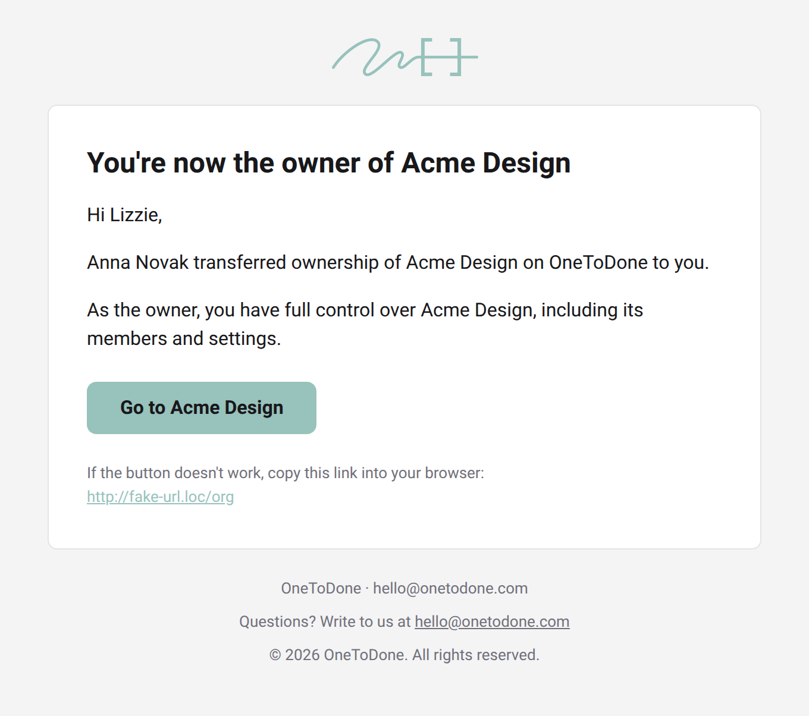

Send it to the new owner when ownership of an organization, team or workspace is transferred.

| Prop                | Type     | Required | Description                                                                                                                |
| ------------------- | -------- | -------- | -------------------------------------------------------------------------------------------------------------------------- |
| `organizationName`  | `string` | yes      | Name of the organization, team or workspace.                                                                               |
| `userName`          | `string` | no       | Name for the greeting. Without it, or when it is empty, the greeting has no name.                                          |
| `previousOwnerName` | `string` | no       | Name of the previous owner. Without it, the email does not say who transferred the ownership.                              |
| `organizationUrl`   | `string` | no       | Absolute `http:` or `https:` link to the organization in your app, shown as a button. Without it, the email has no button. |

## `ownershipTransferred`

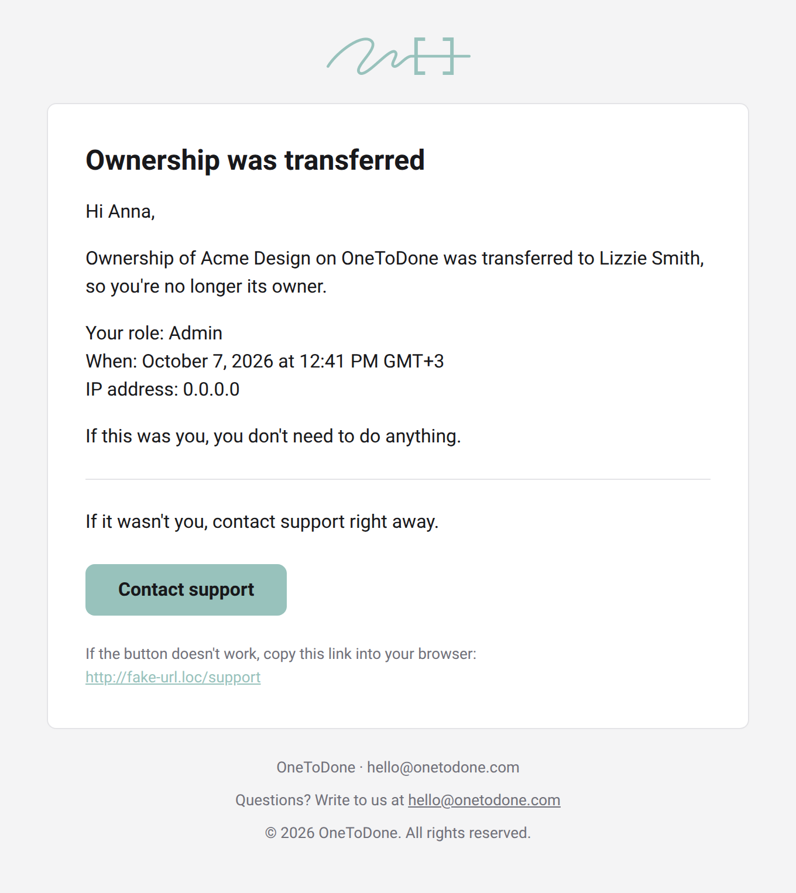

Send it to the former owner, so they can act if they did not make the transfer.

| Prop               | Type     | Required | Description                                                                                                                         |
| ------------------ | -------- | -------- | ----------------------------------------------------------------------------------------------------------------------------------- |
| `organizationName` | `string` | yes      | Name of the organization, team or workspace.                                                                                        |
| `userName`         | `string` | no       | Name for the greeting. Without it, or when it is empty, the greeting has no name.                                                   |
| `newOwnerName`     | `string` | no       | Name of the new owner. Without it, the email says another member.                                                                   |
| `newRole`          | `string` | no       | The recipient's role after the transfer, such as `Admin`.                                                                           |
| `transferredAt`    | `Date`   | no       | When the ownership was transferred.                                                                                                 |
| `timeZone`         | `string` | no       | IANA time zone for `transferredAt`, such as `Europe/Berlin`. Default: the mailer's `timeZone`, which is UTC unless you set it.      |
| `ip`               | `string` | no       | IP address the transfer came from.                                                                                                  |
| `supportUrl`       | `string` | no       | Absolute `http:` or `https:` link to your support page, shown as a button. Without it, the email points to `branding.supportEmail`. |

A transfer uses both:

```ts
await mailer.send('ownershipReceived', {
  to: 'tom@example.com',
  props: { organizationName: 'Acme Design', previousOwnerName: 'Lizzie' },
})
await mailer.send('ownershipTransferred', {
  to: 'lizzie@example.com',
  props: { organizationName: 'Acme Design', newOwnerName: 'Tom', newRole: 'Admin', transferredAt: new Date() },
})
```

## `passkeyAdded` and `passkeyRemoved`

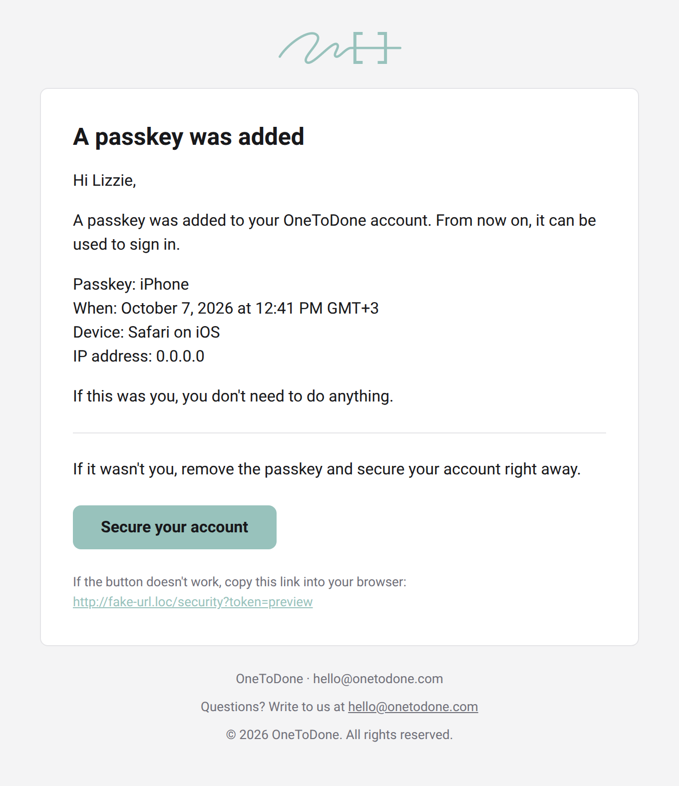 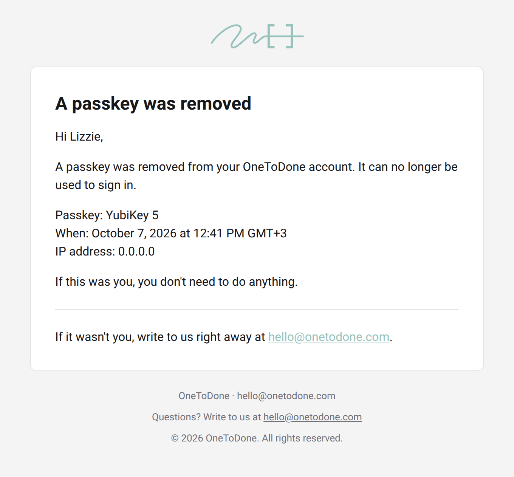

Send them when a passkey is added to or removed from an account. Both take the same props. Every prop is optional, so `props` can be left out.

| Prop          | Type     | Description                                                                                                                                                          |
| ------------- | -------- | -------------------------------------------------------------------------------------------------------------------------------------------------------------------- |
| `userName`    | `string` | Name for the greeting. Without it, or when it is empty, the greeting has no name.                                                                                    |
| `passkeyName` | `string` | Name of the passkey, such as `iPhone` or `YubiKey 5`.                                                                                                                |
| `changedAt`   | `Date`   | When the passkey was added or removed.                                                                                                                               |
| `timeZone`    | `string` | IANA time zone for `changedAt`, such as `Europe/Berlin`. Default: the mailer's `timeZone`, which is UTC unless you set it.                                           |
| `ip`          | `string` | IP address the change came from.                                                                                                                                     |
| `device`      | `string` | Device or browser the change came from, such as `Safari on iOS`.                                                                                                     |
| `secureUrl`   | `string` | Absolute `http:` or `https:` link to a page where the owner secures the account and manages passkeys, shown as a button. Without it, the email points to support.    |
| `supportUrl`  | `string` | Absolute `http:` or `https:` link to your support page, shown as a button when there is no `secureUrl`. Without either, the email points to `branding.supportEmail`. |

## `recoveryCodeUsed`

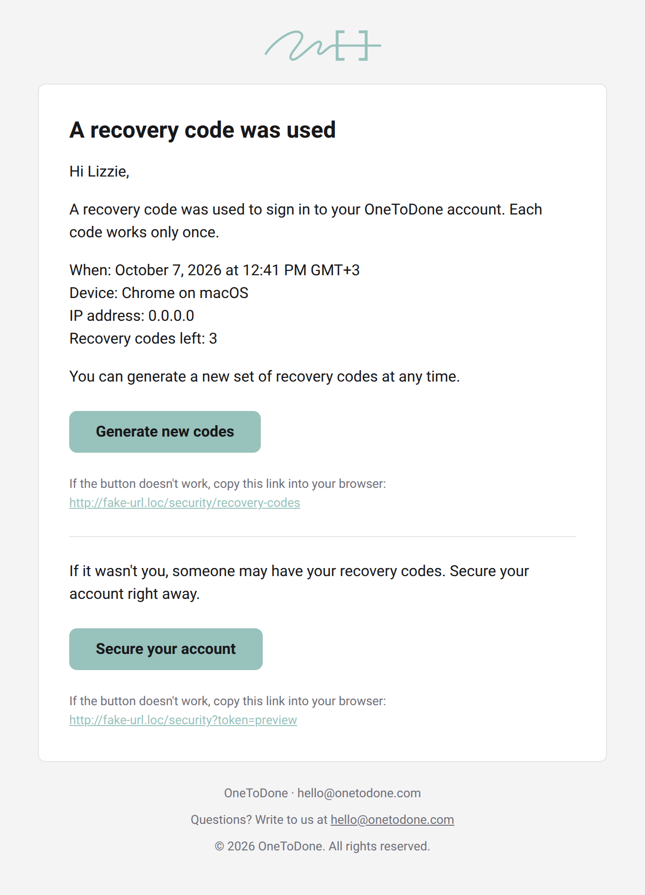

Send it when someone signs in with a two-factor recovery code (also called a backup code). Every prop is optional, so `props` can be left out.

| Prop             | Type     | Description                                                                                                                                                          |
| ---------------- | -------- | -------------------------------------------------------------------------------------------------------------------------------------------------------------------- |
| `userName`       | `string` | Name for the greeting. Without it, or when it is empty, the greeting has no name.                                                                                    |
| `usedAt`         | `Date`   | When the code was used.                                                                                                                                              |
| `timeZone`       | `string` | IANA time zone for `usedAt`, such as `Europe/Berlin`. Default: the mailer's `timeZone`, which is UTC unless you set it.                                              |
| `ip`             | `string` | IP address the sign-in came from.                                                                                                                                    |
| `device`         | `string` | Device or browser of the sign-in, such as `Chrome on macOS`.                                                                                                         |
| `remainingCodes` | `number` | How many unused codes are left, shown as "Recovery codes left: 3". At `0`, the email asks the owner to generate new ones.                                            |
| `regenerateUrl`  | `string` | Absolute `http:` or `https:` link to a page where the owner generates new codes, shown as a button.                                                                  |
| `secureUrl`      | `string` | Absolute `http:` or `https:` link to a page where the owner secures the account, shown as a button. Without it, the email points to support.                         |
| `supportUrl`     | `string` | Absolute `http:` or `https:` link to your support page, shown as a button when there is no `secureUrl`. Without either, the email points to `branding.supportEmail`. |

```ts
await mailer.send('recoveryCodeUsed', {
  to: 'lizzie@example.com',
  props: {
    usedAt: new Date(),
    remainingCodes: 0,
    regenerateUrl: 'https://example.com/security/recovery-codes',
  },
})
```

## `apiKeyCreated`

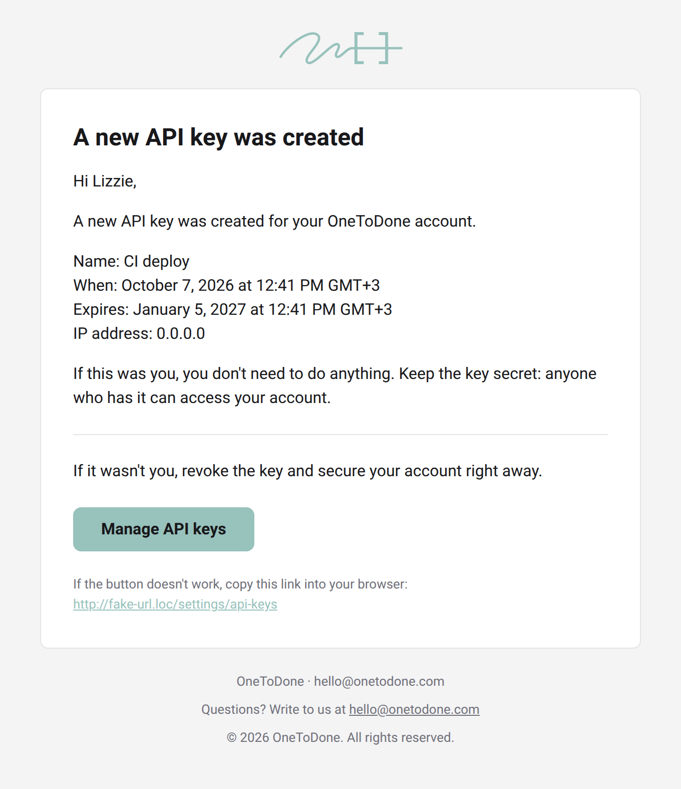

Send it when an API key or personal access token is created. Never put the key itself in an email: the template has no prop for it. Every prop is optional, so `props` can be left out.

| Prop         | Type     | Description                                                                                                                                                          |
| ------------ | -------- | -------------------------------------------------------------------------------------------------------------------------------------------------------------------- |
| `userName`   | `string` | Name for the greeting. Without it, or when it is empty, the greeting has no name.                                                                                    |
| `keyName`    | `string` | Name or label of the key, such as `CI deploy`.                                                                                                                       |
| `createdAt`  | `Date`   | When the key was created.                                                                                                                                            |
| `expiresAt`  | `Date`   | When the key expires.                                                                                                                                                |
| `timeZone`   | `string` | IANA time zone for the dates, such as `Europe/Berlin`. Default: the mailer's `timeZone`, which is UTC unless you set it.                                             |
| `ip`         | `string` | IP address the key was created from.                                                                                                                                 |
| `manageUrl`  | `string` | Absolute `http:` or `https:` link to the page where the owner manages and revokes keys, shown as a button. Without it, the email points to support.                  |
| `supportUrl` | `string` | Absolute `http:` or `https:` link to your support page, shown as a button when there is no `manageUrl`. Without either, the email points to `branding.supportEmail`. |

## `apiKeyExpiring`

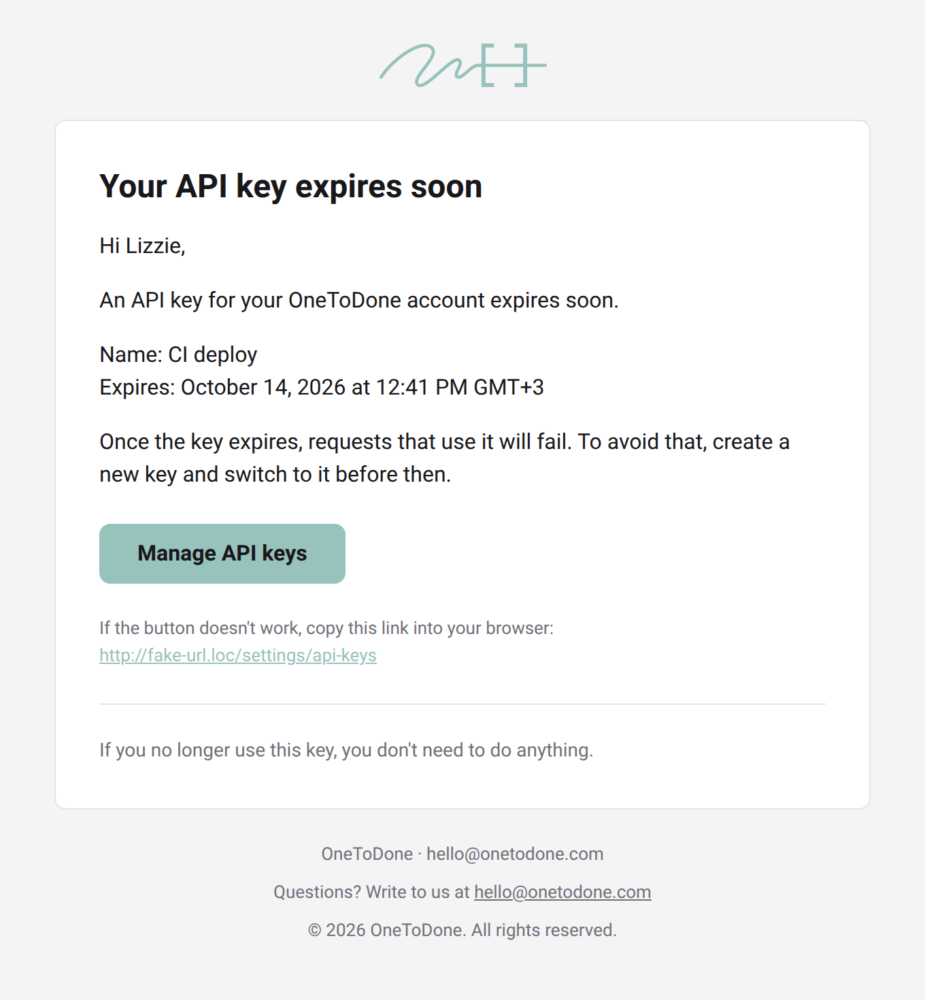

Send it some days before an API key or personal access token expires, so the owner can replace it before requests start to fail.

| Prop        | Type     | Required | Description                                                                                                                                     |
| ----------- | -------- | -------- | ----------------------------------------------------------------------------------------------------------------------------------------------- |
| `expiresAt` | `Date`   | yes      | When the key expires.                                                                                                                           |
| `userName`  | `string` | no       | Name for the greeting. Without it, or when it is empty, the greeting has no name.                                                               |
| `keyName`   | `string` | no       | Name or label of the key, such as `CI deploy`.                                                                                                  |
| `timeZone`  | `string` | no       | IANA time zone for `expiresAt`, such as `Europe/Berlin`. Default: the mailer's `timeZone`, which is UTC unless you set it.                      |
| `manageUrl` | `string` | no       | Absolute `http:` or `https:` link to the page where the owner creates and manages keys, shown as a button. Without it, the email has no button. |

## `accountUnlocked`

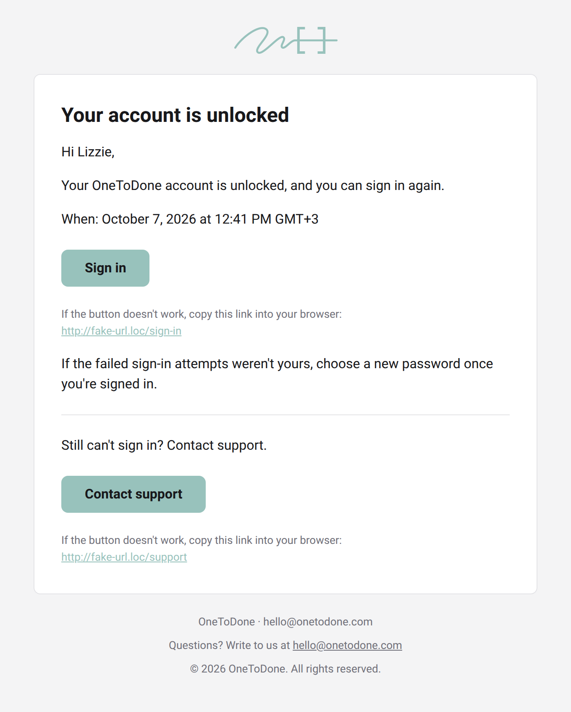

Send it when a locked account is unlocked, for example when the lock from `accountLocked` ends early or support lifts it. Every prop is optional, so `props` can be left out.

| Prop         | Type     | Description                                                                                                                         |
| ------------ | -------- | ----------------------------------------------------------------------------------------------------------------------------------- |
| `userName`   | `string` | Name for the greeting. Without it, or when it is empty, the greeting has no name.                                                   |
| `unlockedAt` | `Date`   | When the account was unlocked.                                                                                                      |
| `timeZone`   | `string` | IANA time zone for `unlockedAt`, such as `Europe/Berlin`. Default: the mailer's `timeZone`, which is UTC unless you set it.         |
| `signInUrl`  | `string` | Absolute `http:` or `https:` link behind the "Sign in" button. Default: `branding.appUrl`.                                          |
| `supportUrl` | `string` | Absolute `http:` or `https:` link to your support page, shown as a button. Without it, the email points to `branding.supportEmail`. |

## `dataExportReady`

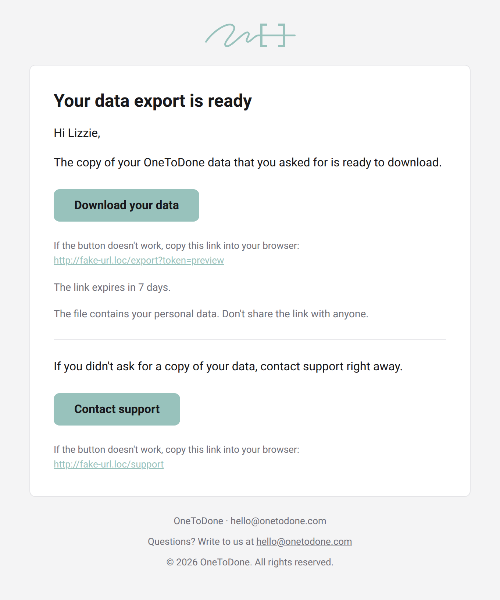

Send it when a copy of the user's data, such as one asked for under the GDPR, is ready to download. The email warns not to share the link.

| Prop               | Type     | Required | Description                                                                                                                         |
| ------------------ | -------- | -------- | ----------------------------------------------------------------------------------------------------------------------------------- |
| `downloadUrl`      | `string` | yes      | Absolute `http:` or `https:` link that downloads the export.                                                                        |
| `userName`         | `string` | no       | Name for the greeting. Without it, or when it is empty, the greeting has no name.                                                   |
| `expiresInMinutes` | `number` | no       | How long the link works, in minutes, such as `10080` for 7 days. Without it, the email does not mention expiry.                     |
| `supportUrl`       | `string` | no       | Absolute `http:` or `https:` link to your support page, shown as a button. Without it, the email points to `branding.supportEmail`. |

## `inactiveAccountWarning`

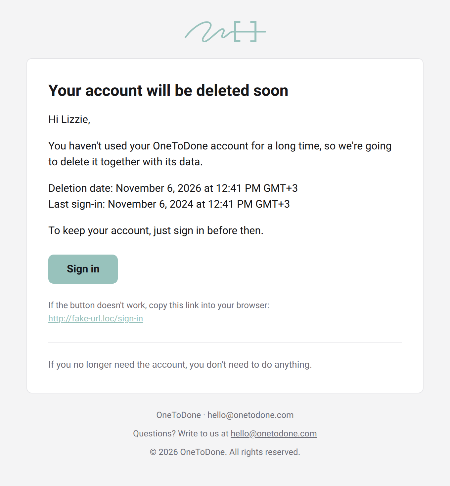

Send it when an inactive account is going to be deleted unless the owner signs in.

| Prop           | Type     | Required | Description                                                                                                              |
| -------------- | -------- | -------- | ------------------------------------------------------------------------------------------------------------------------ |
| `deletionDate` | `Date`   | yes      | When the account will be deleted.                                                                                        |
| `userName`     | `string` | no       | Name for the greeting. Without it, or when it is empty, the greeting has no name.                                        |
| `lastSignInAt` | `Date`   | no       | When the owner last signed in.                                                                                           |
| `timeZone`     | `string` | no       | IANA time zone for the dates, such as `Europe/Berlin`. Default: the mailer's `timeZone`, which is UTC unless you set it. |
| `signInUrl`    | `string` | no       | Absolute `http:` or `https:` link behind the "Sign in" button. Default: `branding.appUrl`.                               |

```ts
await mailer.send('inactiveAccountWarning', {
  to: 'lizzie@example.com',
  props: { deletionDate: new Date(Date.now() + 30 * 24 * 60 * 60_000) },
})
```

## `policyUpdated`

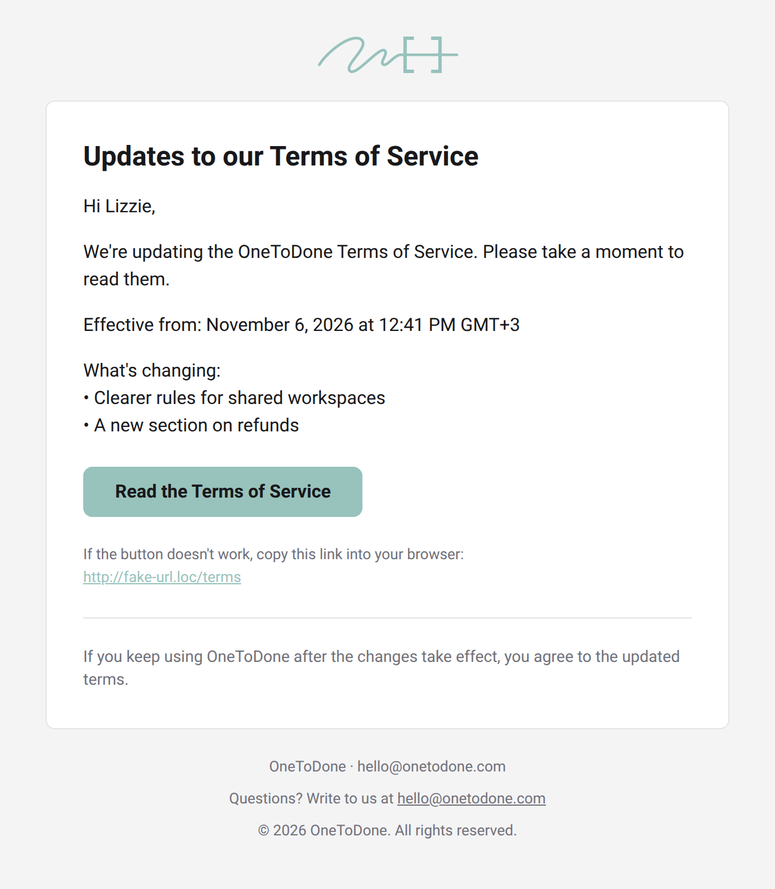

Send it when your terms of service or privacy policy change. `policy` picks the texts: the terms of service email ends with a note that using the app after the changes means accepting them, the privacy policy email with a note that the reader does not need to do anything.

| Prop          | Type                   | Required | Description                                                                                                                  |
| ------------- | ---------------------- | -------- | ---------------------------------------------------------------------------------------------------------------------------- |
| `policy`      | `'terms' \| 'privacy'` | yes      | Which document changed.                                                                                                      |
| `policyUrl`   | `string`               | yes      | Absolute `http:` or `https:` link to the updated document.                                                                   |
| `userName`    | `string`               | no       | Name for the greeting. Without it, or when it is empty, the greeting has no name.                                            |
| `effectiveAt` | `Date`                 | no       | When the changes take effect.                                                                                                |
| `timeZone`    | `string`               | no       | IANA time zone for `effectiveAt`, such as `Europe/Berlin`. Default: the mailer's `timeZone`, which is UTC unless you set it. |
| `changes`     | `readonly string[]`    | no       | Short summaries of the main changes, shown as a list. Pass them in the recipient's language.                                 |

```ts
await mailer.send('policyUpdated', {
  to: 'lizzie@example.com',
  locale: 'de',
  props: {
    policy: 'privacy',
    policyUrl: 'https://example.com/privacy',
    effectiveAt: new Date('2026-12-01T00:00:00Z'),
    changes: ['Neuer Abschnitt zu Analysediensten'],
  },
})
```

Durations are written in whole days (from 2 days on), hours or minutes, with the plural rules of the locale: `30` gives "30 minutes", `60` gives "1 hour", `1440` gives "24 hours" and `2880` gives "2 days". Dates include the time zone name, such as "May 4, 2026 at 9:30 AM UTC".

Props are checked twice. TypeScript reports missing, unknown or mistyped props, and at runtime invalid values, such as a `javascript:` link, throw a `MailerError` with code `INVALID_PROPS`.
